# Pipeline & Algorithms Guide

A step-by-step, visual walkthrough of every stage of `gtfs-ingest`: what goes
in, the exact algorithm applied, what comes out, the parameters that control
it, and what to watch for when you read the result.

| Document | Answers |
| --- | --- |
| `README.md` | How do I install, configure and run it? |
| `WORKFLOW.md` | What happens to the data, organized by concern? |
| **this guide** | What does each step compute, **in execution order**, and why? |

**About the visuals.** Diagrams are Mermaid; they render on GitHub, in the
Sphinx site, and in VS Code with a Mermaid preview extension. Charts are PNGs
in `docs/figures/`. Figures prefixed `e` are synthetic explanations; figures
prefixed `r` are measured on the Guadalajara run in `outputs/out_mibici_v2/` (two GTFS
feeds + the MiBici stops CSV, OSM network walk, `--proximity-m 300`).
Regenerate them with `python docs/figures/make_figures.py`.

---

## Contents

- [0. The pipeline at a glance](#0-the-pipeline-at-a-glance)
- [1. Concepts used by every step](#1-concepts-used-by-every-step)
- [Phase 1 — Ingest](#phase-1--ingest) · Steps 1–5
- [Phase 2 — Service analysis](#phase-2--service-analysis) · Steps 6–17
- [Phase 3 — Conflation](#phase-3--conflation) · Steps 18–22
- [Phase 4 and exports](#phase-4-and-exports) · Steps 23–24
- [2. Data model](#2-data-model)
- [3. Worked example: Guadalajara](#3-worked-example-guadalajara)
- [4. Parameter reference](#4-parameter-reference)
- [5. Interpretation pitfalls](#5-interpretation-pitfalls)

---

## 0. The pipeline at a glance

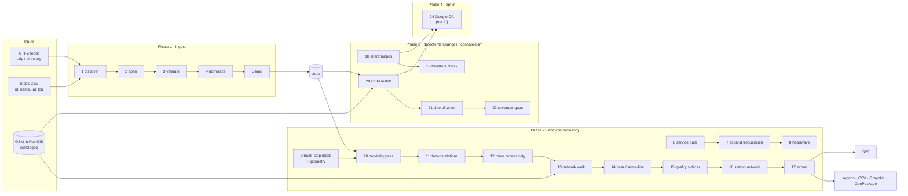

### Run order and data lineage

Steps read what earlier steps wrote. The arrows below are the real
dependencies — which is why `analyze-frequency` runs twice.

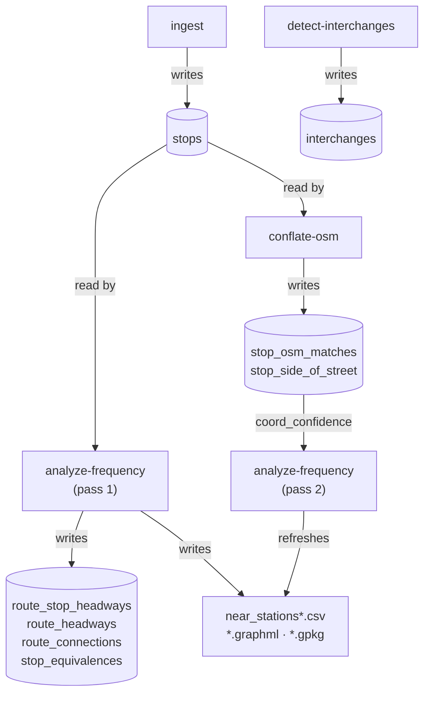

```bash
FEEDS="data/feeds/improved-gtfs-mimacro-mitren-sitren.zip data/feeds/mdb-2366-202502241922.zip data/feeds/mibici.csv"

python -m gtfs_ingest.cli ingest              --feeds $FEEDS --report ./out
python -m gtfs_ingest.cli analyze-frequency   --feeds $FEEDS --report ./out --network-walk --proximity-m 300
python -m gtfs_ingest.cli detect-interchanges --feeds $FEEDS --report ./out
python -m gtfs_ingest.cli conflate-osm                       --report ./out
python -m gtfs_ingest.cli analyze-frequency   --feeds $FEEDS --report ./out --network-walk --proximity-m 300
```

The quality sidecar (Step 15) reads `stop_osm_matches`, which only
`conflate-osm` writes — so the first `analyze-frequency` pass produces
everything else and the second folds in coordinate confidence. The walk graph
is cached, so the second pass is fast. Add `--dry-run` to skip database writes
(not available for `conflate-osm`, which needs OSM in the database).

---

## 1. Concepts used by every step

### 1.1 Identity and provenance

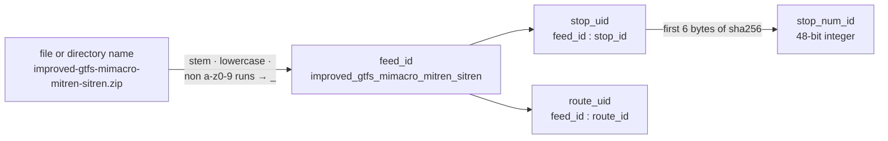

```text
slug = re.sub("[^a-z0-9]+", "_", stem.lower()).strip("_") or "feed"
if slug already used in this run:
    slug += "_" + sha256(absolute_path).hexdigest()[:8]

stop_uid    = f"{feed_id}:{stop_id}"
route_uid   = f"{feed_id}:{route_id}"
stop_num_id = int.from_bytes(sha256(stop_uid.encode()).digest()[:6], "big")
```

- `feed_id` never contains `:`, so `stop_uid` splits back unambiguously.
- A CSV `S1` and a GTFS `S1` coexist: different `feed_id`, different `stop_uid`.
- `stop_num_id` collision odds are about n²/2⁴⁹ — about 10⁻⁴ at 150,000 stops;
  a unique index would surface one as a load error rather than corrupt data.

### 1.2 Coordinate systems

| Where | CRS | Why |
| --- | --- | --- |
| Data at rest (database, files) | EPSG:4326 | GTFS's own datum; never reprojected at rest |
| Planar math (DBSCAN, local proximity, walk graph, side of street) | auto-detected UTM zone (32613 here) | distances in metres |
| Authoritative distances | PostGIS `geography` | geodesic metres |
| OSM layers | read from the data (3857 here) | transformed on the fly |

### 1.3 Failure isolation

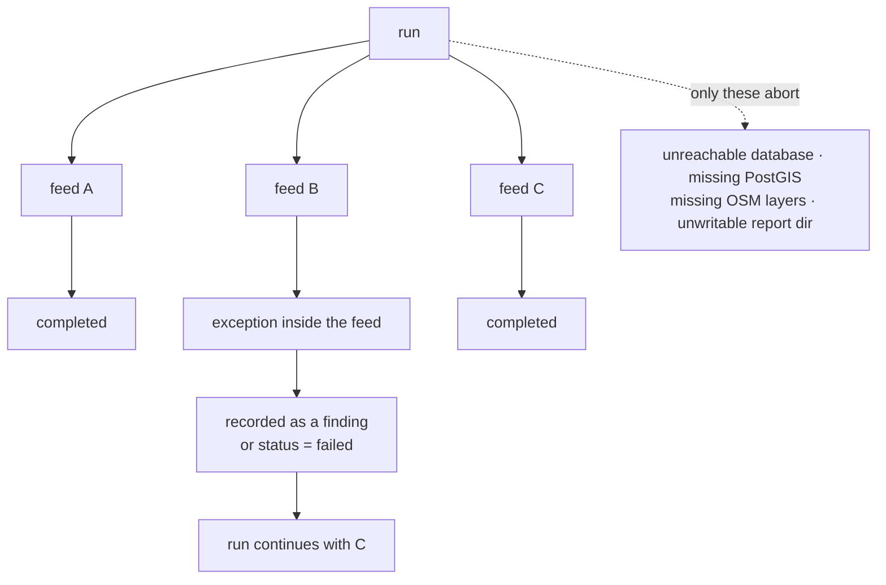

### 1.4 Idempotency — how re-runs replace data

| Table kind | Strategy | Tables |
| --- | --- | --- |
| Feed-scoped | `DELETE … WHERE feed_id` + insert, one transaction | `stops`, `route_stop_headways`, `route_headways` |
| Run-scoped derived | truncate and reload | `route_connections`, `stop_equivalences`, `interchanges`, `stop_osm_matches`, `stop_side_of_street` |
| Budgeted verdicts | per-row upsert | `google_qa_interchange`, `google_qa_stop` |

For run-scoped tables, **pass every source you care about in one run**: a run
with two feeds leaves only those two feeds' connections in the table.

### 1.5 Records versus stations

Deduplication (Step 11) records that several stop records are one physical
station; **it never deletes rows**. Count stations, not records:

```sql
COUNT(DISTINCT COALESCE(NULLIF(station_dedup, ''), stop_uid))
```

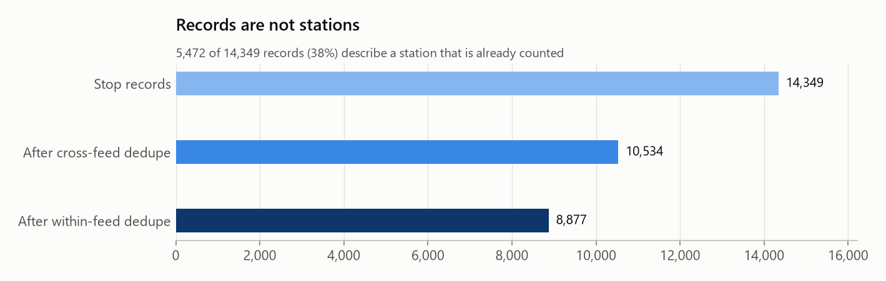

---

## Phase 1 — Ingest

Command `ingest` · module `pipeline_phase1.py`.

### Step 1. Discover sources

**Module** `loader.discover_feeds` · **input** the `--feeds` paths ·
**output** `FeedSource(feed_id, path, kind)` list.

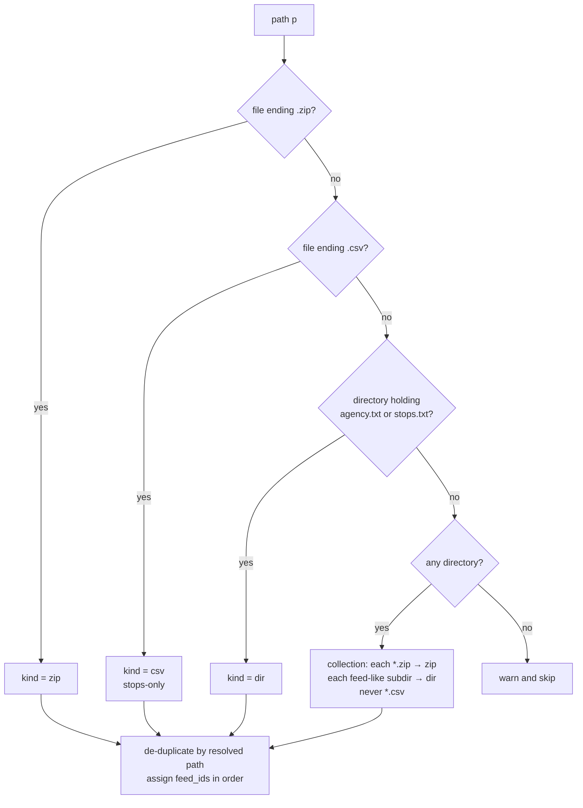

The kind is fixed **at classification time**, so a directory named `foo.zip`
stays a directory.

**Why a CSV must be named explicitly.** The pipeline's own
`near_stations.csv` has `ID`, `stop_lat` and `stop_lon` columns, which resolve
as a valid stops CSV. If directories were scanned for CSVs, pointing `--feeds`
at a folder containing a previous run's output would silently re-ingest the
whole network as a second feed.

### Step 2. Open each source

**Module** `loader.load_feed` · **output** `LoadedFeed`.

**GTFS sources** are opened lazily with `partridge.load_raw_feed`, every column
kept as a string so validation sees the file exactly as published. If the
container cannot be opened, `feed = None` and `load_error` explains why.

**Stops-only CSVs** use `stops_csv.read_stops_csv`:

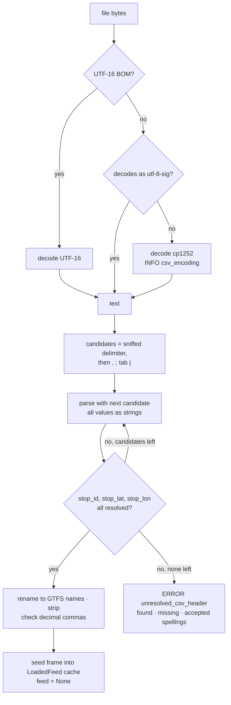

**Header resolution.** Each header cell is normalized and looked up in an
alias table:

```text
normalize(cell) = strip BOM and quotes
                  -> NFKD, drop combining accents
                  -> casefold
                  -> every run of non-alphanumerics -> "_"
lookup(normalize(cell)) -> canonical column, first column in file order wins
```

| Canonical | Accepted spellings (compared after normalization) |
| --- | --- |
| `stop_id` | id, stop_id, stopid, codigo, clave |
| `stop_name` | name, stop_name, stopname, nombre, estacion |
| `stop_lat` | latitude, lat, stop_lat, latitud |
| `stop_lon` | longitude, lon, lng, long, stop_lon, longitud |

Details that matter:

- **Delimiter detection is outcome-driven.** The sniffer only picks which
  delimiter to try first; the one that yields a resolvable header wins.
- **`utf-8-sig` is tried first on purpose.** Excel on Spanish-locale Windows
  writes semicolon-separated UTF-8 with a byte-order mark; partridge cannot
  read that, because its column cleanup leaves the BOM glued to the first
  column name.
- **Decimal commas are flagged, never rewritten.** `20,6736` raises a
  `csv_decimal_comma` warning, and the row is later dropped as an invalid
  coordinate.
- Unknown columns (such as MiBici's `dpcapacity`) are ignored.
- The frame is **pre-seeded** into the `LoadedFeed` table cache. Table access
  consults that cache before the partridge object, so every later step reads a
  CSV source exactly like a GTFS feed.

### Step 3. Validate

**Module** `validators.validate_feed`. Every check runs; a crashing check
becomes an ERROR `validator_crash` rather than stopping the run.

| # | Check | Finding | Severity |
| --- | --- | --- | --- |
| 1 | agency, stops, routes, trips, stop_times present | `missing_required_file` | ERROR |
| 1 | calendar.txt **or** calendar_dates.txt present | `missing_calendar` | ERROR |
| 2 | each present file parses; required files non-empty | `unreadable_file`, `empty_required_file` | ERROR |
| 3 | required columns per file | `missing_required_columns` | ERROR |
| 4 | stops: non-null `stop_id` | `null_stop_id` | ERROR |
| 4 | stops: unique `stop_id` | `duplicate_stop_ids` | ERROR |
| 4 | stops: coordinates parse and lie in WGS84 range | `invalid_coordinates` | ERROR |
| 4 | stops: `parent_station` references a known stop | `dangling_parent_station` | WARNING |
| 5 | trips→routes, stop_times→trips, stop_times→stops | `dangling_reference` | ERROR |
| 6 | declared service ends before the analysis date | `feed_expired` | WARNING |
| 7 | optional-file inventory | `optional_files` | INFO |

Severity policy: **ERROR** = spec violation or data loss; **WARNING** =
recoverable; **INFO** = inventory. `ingest --fail-on-error` exits 2 on any
ERROR.

**Stops-only sources** replace check 1 with one INFO `stops_only_source` — a
stops CSV cannot have routes or calendars. Checks 2–7 still run in full, so a
bad coordinate in a CSV raises the same finding as in a GTFS feed.

### Step 4. Normalize stops

**Module** `normalizer.normalize_stops`.

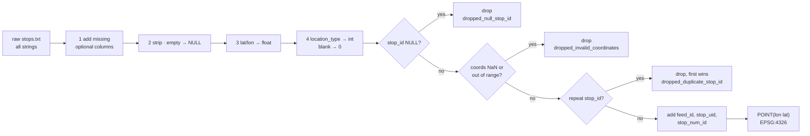

**Output columns:** `stop_uid, stop_num_id, feed_id, stop_id, stop_name,
stop_lat, stop_lon, location_type, parent_station, geometry`.

Validation reports; normalization repairs **by exclusion only** — it never
guesses a value. Drop counts mirror the validator codes, so
`source rows − dropped = normalized rows` is always reconstructible.

### Step 5. Load stops into PostGIS

**Module** `db.load_feed_stops`.

```sql
BEGIN;
DELETE FROM stops WHERE feed_id = :feed_id;                 -- idempotency
CREATE TEMP TABLE tmp_stops (...) ON COMMIT DROP;
COPY tmp_stops FROM STDIN;                                  -- bulk stage
INSERT INTO stops (..., geom)
SELECT ..., ST_SetSRID(ST_MakePoint(stop_lon, stop_lat), 4326)
FROM tmp_stops;
COMMIT;
```

If `COPY` fails, the same rows go through chunked `executemany` (1,000 rows per
chunk) inside the same transaction. Indexes: GiST on `geom`, B-tree on
`feed_id`, unique on `stop_num_id`.

---

## Phase 2 — Service analysis

Command `analyze-frequency` · module `analysis/pipeline_phase2.py`.

Steps 6–9 run **per feed**, each inside its own failure boundary. Steps 10–17
run **once across all feeds**.

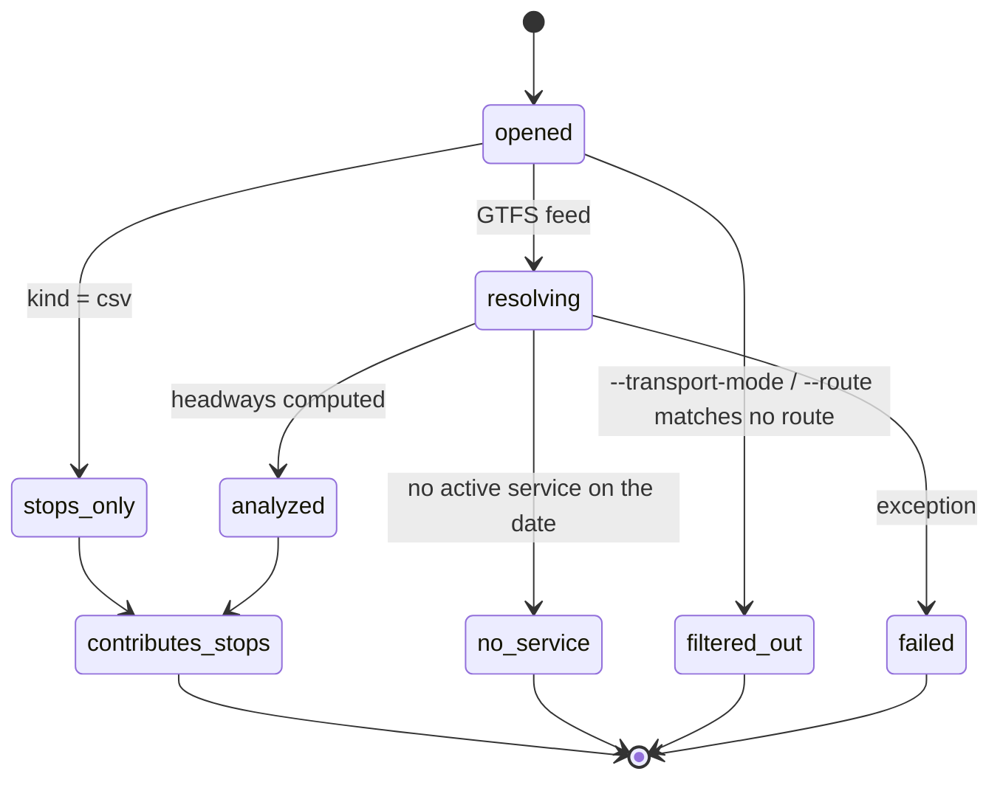

A **stops-only** source branches out before any service-date logic: it is
normalized and loaded, marked `stops_only` with no service date, and still
takes part in Steps 10–17. It is exempt from `--transport-mode`/`--route` (it
has no route attributes to match) and excluded from `--common-date`.

### Step 6. Resolve the service date

**Module** `analysis/service_filter.py`.

```text
active_service_ids(date) =
      { s : calendar[s].weekday(date) == 1  and  start_date <= date <= end_date }
    ∪ { s : calendar_dates has (s, date, exception_type = 1) }
    − { s : calendar_dates has (s, date, exception_type = 2) }
```

| Mode | Flag | Algorithm |
| --- | --- | --- |
| Explicit | `--service-date D` | use D |
| Busiest (default) | none | per feed, the date with the most active trips |
| Common | `--common-date` | `max( ∩ over feeds of {dates with non-empty service} )`; exit 1 if the intersection is empty |
| Range | `--service-date-range A..B` | every served date in `[A, B]`, each analyzed separately; ≤ 31 days |

The active `service_id` set becomes a partridge **view**
(`trips.service_id ∈ active`), which cascades: `stop_times`, `routes` and
`shapes` are filtered consistently through their foreign keys. Times become
seconds since service-day midnight, and values past 24:00 are kept
(`25:10:00` → 90,600 s), so late-night service stays attributed to its
service day.

When feeds resolve to different days the report sets
`service_dates_coherent: false`, because cross-feed outputs then mix schedules
from different dates.

### Step 7. Expand frequencies.txt

**Module** `headways.expand_frequencies`.

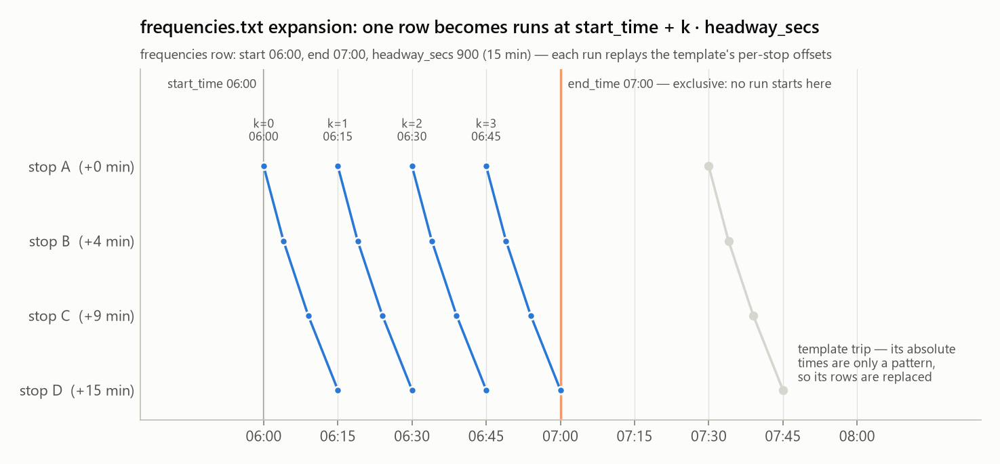

A frequency-defined trip's `stop_times` describe a travel-time **pattern**,
not real departures. Each `frequencies.txt` row is turned into concrete runs:

```text
valid rows: start_time, end_time, headway_secs all numeric,
            headway_secs > 0, end_time > start_time        (others skipped, warned)

for each valid row (trip, start, end, headway):
    n_runs  = ceil((end - start) / headway)                # end is exclusive
    n_runs  = min(n_runs, 1000)                            # corrupt-row guard
    offsets = {stop: departure_time(stop) - min departure_time of the trip}
    for k in 0 .. n_runs-1:
        run_start = start + k * headway
        emit (trip, stop, run_start + offset) for every stop

drop exact duplicate (trip, stop, departure) rows          # overlapping ranges
replace the trip's template rows with its runs             # replace, never add
```

- `exact_times` 0 and 1 expand identically; the flag only describes real-world
  adherence.
- Duplicate removal matters: two overlapping frequency ranges for one trip
  would otherwise create zero-second gaps and corrupt `min_headway_s`.
- In these feeds 181 of 184 and 970 of 989 trips are frequency-based, so
  without expansion the headways would be meaningless.

### Step 8. Compute headways

**Module** `headways.compute_stop_headways`, `headways.route_rollup`.

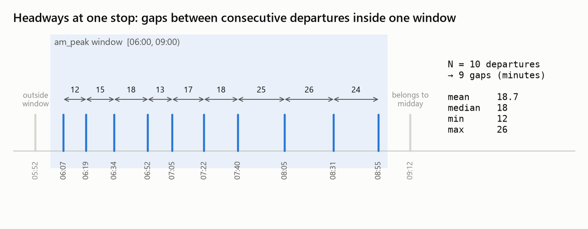

A **headway** is the gap between consecutive scheduled departures at one stop,
for one `(route, direction)`, inside one half-open window `[start, end)`.

```text
departures = stop_times ⋈ trips  →  (route_id, direction_id, stop_id, departure_s)
             blank direction_id → -1 ;  rows without departure_time dropped
             mixed-sense routes: direction_id from stop order (below)

for each window w in [am_peak 06-09, midday 09-15, pm_peak 15-19, evening 19-23]:
    rows = departures where w.start <= departure_s < w.end
    sort rows by departure_s
    gap  = departure_s - previous departure_s within the same (route, direction, stop)
    per (route, direction, stop):
        trip_count     = number of departures
        mean / median / min / max_headway_s = statistics of gap     # N-1 gaps
                                                                    # N = 1 → NULL stats
```

**Route rollup** per `(route, direction, window)` — deliberately simple and
documented:

```text
mean_headway_s     = mean of stop-level mean_headway_s (stops with >= 2 departures)
stop_count         = distinct stops with any departure
stops_with_headway = stops whose headway is defined
trip_count         = max stop-level trip_count          # proxy for corridor runs
```

The rollup is **unweighted**: every stop counts equally, whatever its
position on the route.

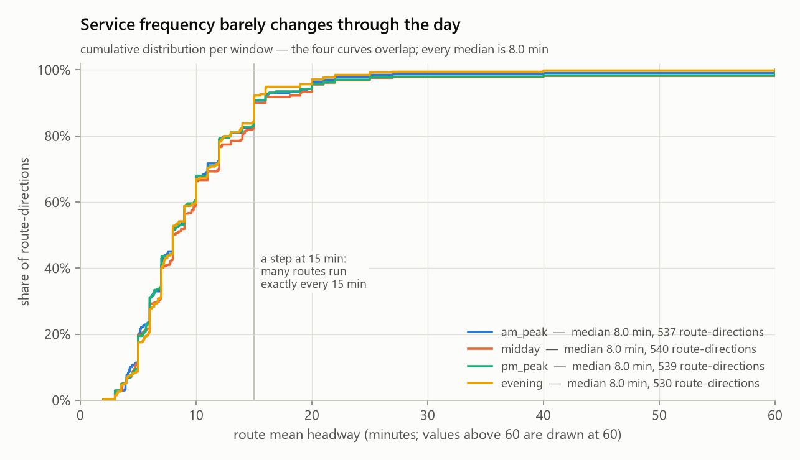

Measured: route headways are almost identical across the four windows (medians
5.3–5.4 minutes). These feeds define service through `frequencies.txt` with
uniform headways all day, so time-of-day variation is not present in the
source data. The step at 15 minutes marks the many routes that run exactly
every quarter hour.

### Step 9. Build route–stop maps and route geometry

**Modules** `connectivity.route_stop_map`, `route_geometry.py`.

**Route–stop map** — the source of every "is this stop served?" decision
downstream:

```text
route_stops = distinct (route_id, stop_id) from stop_times ⋈ trips   (analyzed day only)
```

**Route shapes** — `shapes.txt` points ordered by `shape_pt_sequence`, one
polyline per distinct `(route, direction, shape_id)`.

**Route–stop links** — the hops between consecutive stops:

```text
for each trip:
    order rows by numeric stop_sequence, then stop_id (non-numeric dropped)
    keep one stop per stop_sequence     # alias stops listed under one sequence
    next_stop = following row's stop_id
    seg_s     = following departure_time - this departure_time
    seg_s < 0 → NULL                                  # broken sequence, not a time

group by (route_id, direction_id, stop_id, next_stop_id):
    travel_min = round(median(seg_s) / 60, 1)         # NULL when every seg_s is NULL
    n_obs      = count of non-NULL seg_s              # trips behind the median
```

Links use the **un-expanded** template `stop_times` from Step 7 — the pattern
already holds the correct segment times.

Each link then gets a `time_quality` label (the time itself is kept):

```text
untimed   travel_min is NULL
zero      travel_min == 0
too_fast  straight-line km/h between the stops > 80   # the real path is longer
too_slow  route direction: max shape km / median trip minutes < 5 km/h
ok        otherwise
```

### Step 10. Find proximity pairs

**Module** `connectivity.proximity_pairs_postgis` / `proximity_pairs_local`.

```text
pairs = { (a, b) : stop_uid_a < stop_uid_b,  distance(a, b) <= --proximity-m }
```

| Path | Used when | How |
| --- | --- | --- |
| PostGIS | a database is configured | `ST_DWithin(a.geom::geography, b.geom::geography, r)` on the `stops` table, using the GiST index on `geom::geography` (`ix_stops_geog`), restricted to the feeds that contributed stops |
| Local | `--dry-run` | project to UTM; spatial join with `dwithin` on a spatial index |

The PostGIS path reads the **table** and filters by feed id. That list must
include stops-only feeds, or their rows sit in the database and match nothing
— a defect a dry run cannot show, because the local path uses the in-memory
stops and ignores the list.

### Step 11. Deduplicate stations

**Module** `analysis/dedupe.py`.

The same physical station often appears as several stop records — across
feeds, and inside one feed under two id schemes. The two cases use
**deliberately different evidence**.

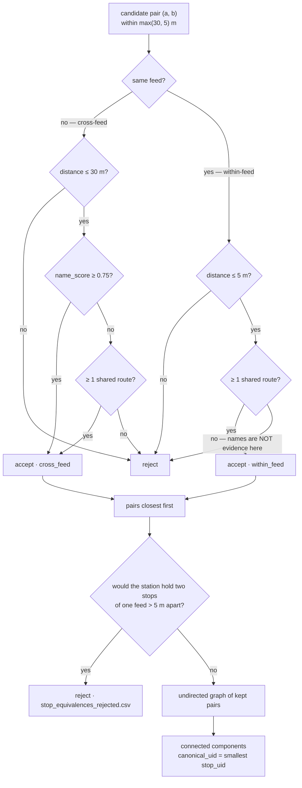

**Evidence functions**

```text
normalize_name(s) = NFKD → drop accents → casefold
                    → non-alphanumerics to spaces → sort tokens → join with " "
name_score(a, b)  = difflib.SequenceMatcher(normalize(a), normalize(b)).ratio()
                    (0.0 when either name is empty)

routes(stop)      = { normalize(route_short_name) of routes serving the stop }
shared_routes     = | routes(a) ∩ routes(b) |

score             = 0.5 · (1 − distance / radius_that_admitted_the_pair)
                  + 0.5 · name_score                       # audit only, never a gate
```

`"Estación Juárez"` and `"JUAREZ, Estacion"` both normalize to
`"estacion juarez"` and score 1.0.

**Why the within-feed rule ignores names.** Two genuinely different stops of
one feed can share a name — a long avenue, a plaza. Two stops of the **same
route** at the same spot, though, are one station recorded twice.

**Why 5 m and not 50 m.** Consecutive stops on a route sit hundreds of metres
apart (median 280 m), but the same route's stop for the *opposite direction*
— across the street, or the other platform of a median station — is 20–40 m
away and shares every route. The former 50 m default merged 2,697 such pairs
(median 28.9 m); duplicate records sit at 0 m, so 5 m keeps them and drops
the direction pairs.

**Stops-only sources are excluded from both rules.** A stops CSV has no routes,
so the within-feed rule could never fire; but the cross-feed *name* rule could
make a dock the alias of a bus stop named after the same corner. Docks are
therefore removed before the spatial pass (`exclude_feeds`).

**Same-feed conflicts.** Grouping is transitive, so one wrong pair can merge
two whole groups. The typical case: both platforms of a street exist in both
feeds (A and B in one, A′ and B′ in the other). A–A′ and B–B′ are true twins
at 0 m, but A–B′ also passes the cross-feed rule (same name, same route,
~28 m), and chaining would make A, B, A′ and B′ one station. So pairs join
stations closest first, and a pair is rejected when the station would hold
two stops of the same feed more than 5 m apart (the within-feed radius).
Rejected pairs are listed in `stop_equivalences_rejected.csv`.

**Grouping**: the kept pairs form a graph, and each connected component is
one physical station, with its smallest `stop_uid` as `canonical_uid`.
Components are ordered by that value, so `group_id`s are deterministic.

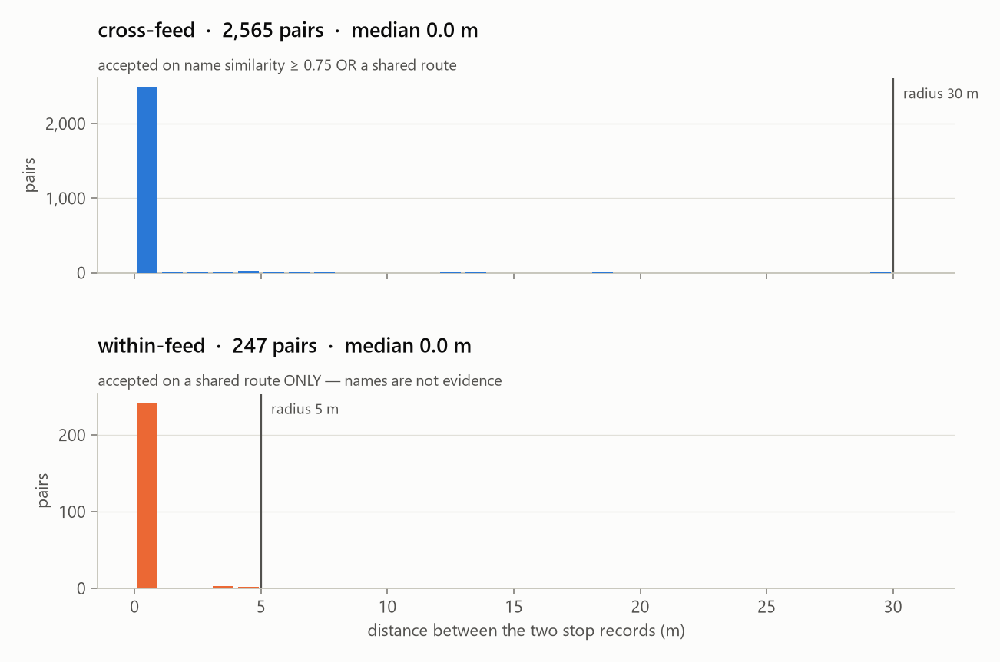

Cross-feed pairs are mostly **exact coordinate copies** (median 0.0 m — the
two feeds share a stop inventory). Within-feed pairs spread across the whole
50 m radius (median 28.9 m), typical of a line published twice with slightly
different platform positions.

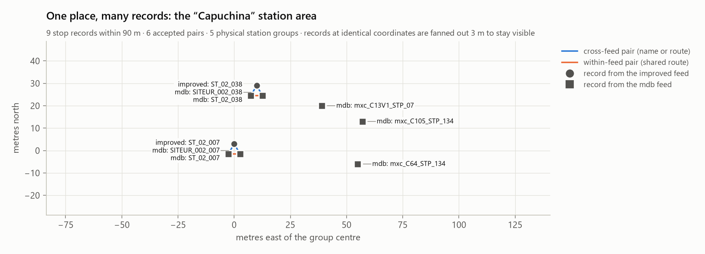

This real example shows both rules at once. Around one SiTren station, 12
records collapse into 3 physical groups: the `improved` feed's `ST_02_007`
matches the `mdb` feed's copies across feeds (blue), and inside `mdb` the
`SITEUR_*` and `ST_*` schemes match each other on shared routes (orange).
(The figure was drawn with the former 50 m within-feed radius, so it also
merges the opposite-direction platforms `ST_02_007` and `ST_02_038`. With the
5 m radius and the same-feed conflict rule they are separate stations.)

Measured on real data, stations now span a median of 0 m and at most 7.5 m:
the same-feed conflict rule rejected 1,077 cross-feed pairs (768 at 15–30 m,
304 at 5–15 m, 5 at 1–5 m, none at ≤ 1 m).

**Effects downstream:** alias pairs are removed from the proximity pairs (a
station is not "near" itself); routes serving aliased stops connect as
`same_station_dedup`; interchange clustering treats each group as
unsplittable.

### Step 11b. One source per line (route dedupe)

**Module** `route_dedupe.match_routes`, `route_dedupe.duplicate_trips`.

A line published by two feeds would run twice in a timetable: double the
frequency, half the waiting time. Route ids and short names can't tell: the
improved feed prefixes mdb's ids (`2215-C98` vs `C98`), and `L1` names both
Mi Tren and Sitren. Stop sets can:

```text
station(stop)   = canonical_uid from Step 11, else stop_uid
jaccard(r1, r2) = |stations(r1) ∩ stations(r2)| / |stations(r1) ∪ stations(r2)|
candidates      = route pairs of different feeds with jaccard >= 0.8
accept best first (jaccard desc, then uids), each route at most once
kept route      = the feed with the later calendar_end
                  (ties: later service date, then smaller feed_id)

inside one feed, per route:
    two trips with the same arrival/departure times and frequencies.txt rows,
    whose stops are pairwise within the within-feed radius (5 m)
    → one trip listed twice; the smallest trip_id is kept
```

True twins score ≥ 0.91 in Guadalajara and every other pair ≤ 0.53; express
variants (`MC-L1E` inside `MC-L1`) score below 0.5, so containment is never
used. Only the **routing inputs** drop the duplicates: the station network
(Step 16), the route graph and its CSVs (Step 12) and the timetable (Step
16b). `routes.csv` keeps every route with `duplicate_of`; headways,
near-stations and `route_stops.csv` keep both feeds. `--no-route-dedupe`
turns it off. The choices are in `route_equivalences.csv` and
`duplicate_trips.csv`.

### Step 12. Build route connectivity

**Module** `connectivity.build_edges`.

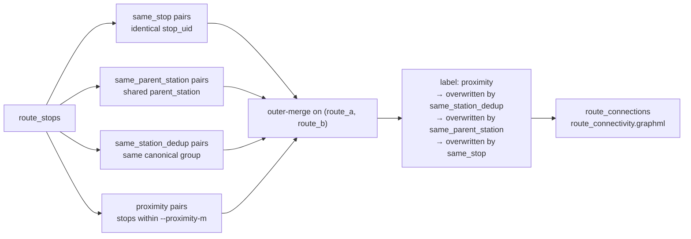

```text
for each rule:
    pairs = route_stops ⋈ relation ⋈ route_stops  on stop
    drop pairs with route_a == route_b ; order so route_a < route_b

outer-merge the four pair sets on (route_a, route_b)
connection_type = strongest rule that produced the pair:
    same_stop > same_parent_station > same_station_dedup > proximity
shared_stop_count   = stops the two routes share
min_stop_distance_m = 0 for same_stop, else the closest proximity pair, else NULL
```

`same_station_dedup` is kept separate from `same_parent_station` because one
is **inferred** and the other **declared by the operator**. Edges are
undirected. Which stops created an edge is aggregated away; the physical
places where routes meet are the interchanges of Step 18.

### Step 13. Route walking distances on OSM streets

**Module** `analysis/walk_network.py` · only with `--network-walk`.

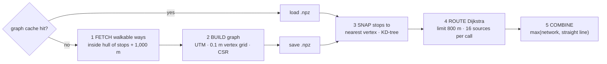

**1 · Fetch.** Ways from `planet_osm_line` with a `highway` tag, excluding
`motorway`, `motorway_link`, `proposed` and `construction`, inside the convex
hull of the analyzed stops buffered by 1,000 m — one indexed query.

**2 · Build.**

```text
for each way (MultiLineStrings split into parts):
    segments = consecutive coordinate pairs
vertices = unique( round(endpoint / 0.1 m) * 0.1 m )        # snap to a 10 cm grid
edge     = (vertex_u, vertex_v, euclidean length)
drop self-loops and zero-length edges
store both directions → compressed sparse row (CSR) arrays
```

Ways connect only where they **share a coordinate** on that grid, which is how
OSM models intersections. Crossings without a shared node (bridges, tunnels)
correctly stay unconnected.

**3 · Snap.** Each stop maps to its nearest graph **vertex** (not the nearest
point on an edge), recording the snap distance. A snap over 200 m is labelled
`unsnapped` in the quality sidecar.

**4 · Route.** Pairs are grouped by source vertex so stops sharing a vertex
are routed once, then run through `scipy.sparse.csgraph.dijkstra` in batches of
16 sources with `limit = 800 m`. Each call allocates a dense
`16 × vertices` array — with 512,420 vertices, about 66 MB — which bounds
memory while amortizing call overhead.

**5 · Combine.**

```text
network_m  = graph path length + snap_a + snap_b
distance_m = max(network_m, straight_line_m)    # a street walk never beats the line
no path within 800 m → keep straight_line_m, walk_source = "straight_line"
```

**Cache.** The graph arrays are saved as compressed `.npz` in `.gtfs_cache/`.
The key hashes every input that shapes the graph — feed ids, hull buffer, OSM
table and geometry column, excluded highways, CRS — plus database probes (line
table row count and maximum `osm_id`, and the stops' latest `loaded_at`), so
an OSM re-import or stop reload invalidates it automatically.

**Placement.** Applied **after** Step 12, so `min_stop_distance_m` stays
geodesic, and **before** Step 14, so walking minutes reflect real streets.

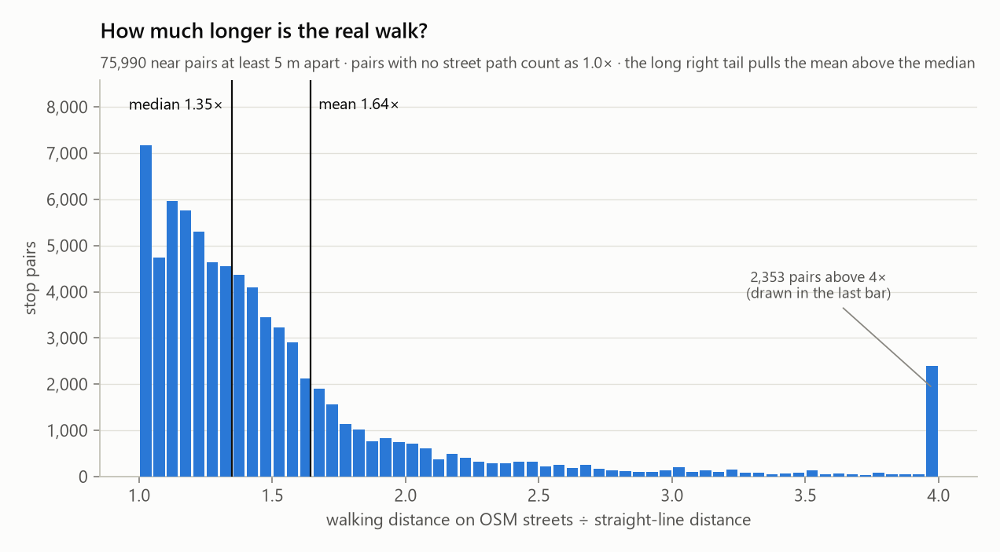

Measured over 90,030 pairs at least 5 m apart: a typical walk is **1.33×** the
straight line (median); the mean is 1.54× because of a long tail, with 1,885
pairs above 4×. The run log reports a higher "mean detour" (63%, i.e. 1.63×)
because it averages routed pairs only and includes near-co-located stops,
whose tiny straight-line distance inflates the ratio. **Use the median** when
you need one factor.

### Step 14. Build near-stations and same-line relations

**Module** `analysis/near_stations.py`.

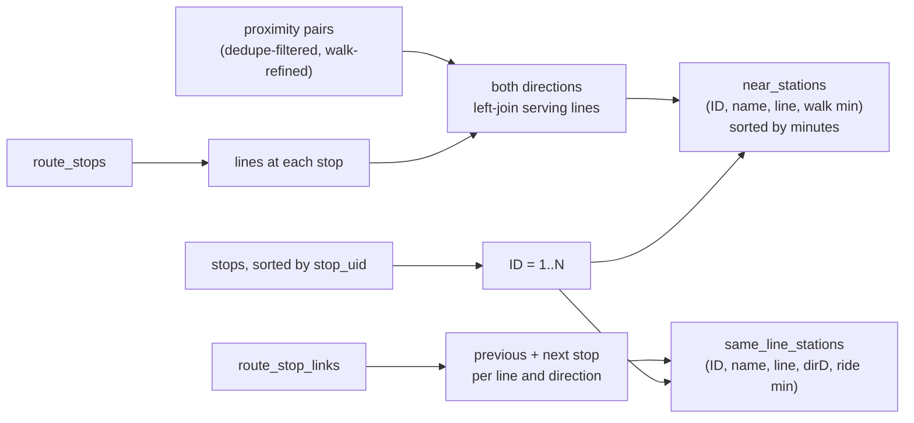

**Node ids.** `ID` is `1..N` in `stop_uid` order and every relation references
stops by it. The same stops always get the same IDs, whatever the input order,
but adding a stop shifts the IDs after it; `stop_uid` is the cross-run key.

**`near_stations` — what can I walk to?**

```text
for each proximity pair (a, b), in both directions:
    for each line serving the neighbour — or "-" if no line serves it:
        emit (ID of neighbour, neighbour name, line, minutes)
minutes = max(1, round(distance_m / 83))          # 83 m/min ≈ 5 km/h
sort each stop's tuples by minutes; render as "[(ID, name, line, minutes), ...]"
```

A neighbour served by no line — a parent-station node, or a MiBici dock — is
still listed, with `-` as its line: it genuinely exists and is genuinely
walkable.

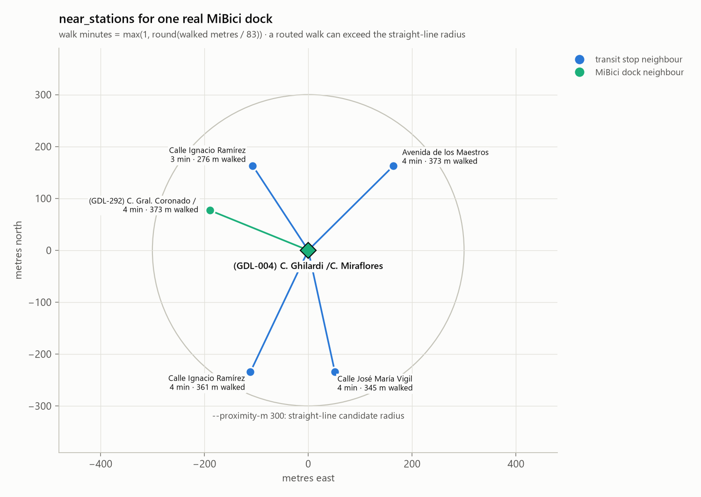

A real dock with five transit neighbours. Note that three walked distances
(292–311 m) exceed the 300 m radius drawn: the radius selects candidates in
**straight-line** distance, and the reported distance is then the **street**
walk from Step 13.

**`same_line_stations` — what comes before and after on my line?**

```text
links_both_ways = links ∪ links with a and b swapped     # previous AND next stop
drop duplicate (stop, neighbour, line, direction)
minutes = travel_min                                     # scheduled, Step 9
          or round(haversine(stop, neighbour) / 416.7 m/min, 1)   # 25 km/h fallback
sort by (line, direction, minutes, ID)
render "[(ID, name, line, dirD, minutes), ...]"
```

The two relations use different inclusion rules on purpose:
`near_stations` is distance-only with no route constraint;
`same_line_stations` is sequence-only with no distance limit.

**Descriptive columns:** `stop_line_ids` = `"{ID}-{line}"` for each line serving
the stop; `system` = distinct agency names of those lines, comma-joined. An
unserved stop has both empty, even when it appears with `-` in other stops'
lists.

### Step 15. Record provenance (quality sidecar)

**Module** `near_stations.build_quality` · file `near_stations_quality.csv`.

In the main file a measured 4 minutes and an estimated 4 minutes look
identical. The sidecar has the same rows and `ID`s and records **how** each
value was obtained; it never changes the main file's format.

| Column | Values | Rule |
| --- | --- | --- |
| `walk_source` | `network`, `straight_line`, `mixed`, `unsnapped`, `none` | the single source label across the stop's rendered neighbours, `mixed` when they disagree; `unsnapped` when the stop's snap exceeded 200 m; `none` with no neighbours |
| `travel_source` | `observed`, `estimated`, `mixed`, `none` | scheduled `travel_min` versus the 25 km/h fallback, same summarizing rule |
| `travel_n_obs` | integer | minimum `n_obs` across the stop's same-line links — the weakest evidence |
| `coord_confidence` | a score like `0.812`, `needs_review`, `no_match`, `unavailable` | from `stop_osm_matches` (Step 20); `unavailable` in dry runs or before `conflate-osm` |
| `station_dedup` | a `canonical_uid` or empty | the stop's dedupe group — **use it to count stations** |

### Step 16. Build the station network

**Module** `analysis/station_network.py` · a routable graph over **places**.

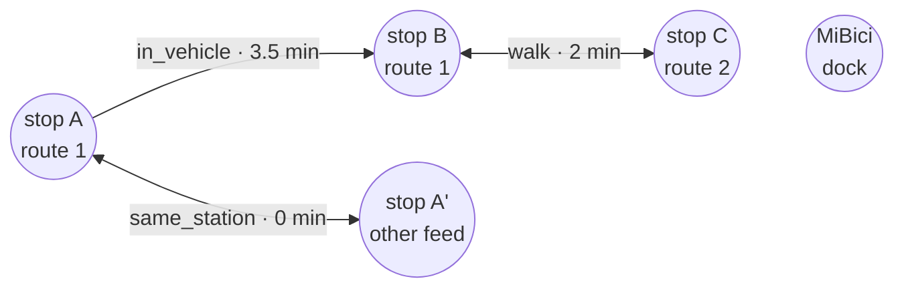

| Element | Built from | Weight `time_min` |
| --- | --- | --- |
| Node | every stop | — (attributes: `near_id`, name, feed, `canonical_uid`, lat, lon; `stops_only` on docks) |
| `in_vehicle` | each route–stop link, **one directed arc** | `travel_min` (NULL when untimed) |
| `walk` | each proximity pair, **two arcs** | `max(1, round(distance_m / 83))` |
| `same_station` | each dedupe pair, **two arcs** | `0.0` |

```python
nx.shortest_path(G, a, b, weight="time_min")  # riding + walking + transferring
```

**Redundant arcs.** A walk pair is redundant when another walking path is as
fast, and a same_station pair when it closes a cycle of 0-minute links. They
are found exactly and deterministically:

1. same_station pairs in `stop_uid` order through a union-find; a pair that
   closes a cycle is redundant (a spanning tree per station remains);
2. walk pairs longest first (`time_min`, then `distance_m`, then uids): drop
   the pair if the remaining walking graph (walk + kept same_station) still
   links its stops within its minutes, otherwise put it back.

Each drop keeps every walking shortest time, so every shortest `time_min`
path of the full network is kept too. The counts are always in the report;
`--prune-station-network` also writes the pruned network. Measured: 42,557 of
72,286 walk pairs and 247 of 2,812 same_station pairs are redundant.

Stops-only nodes (MiBici docks) get **no** `walk` or `same_station` arcs. A
node with walk arcs is a waypoint any shortest path may cross, and a dock
between two bus stops would chain two 300 m walks into one the proximity
radius never allowed (1,901 such stop pairs on the Guadalajara data). The
docks' transit neighbours stay in `near_stations.csv`; the report counts
weak components over transit stops and lists docks as `n_stops_only`.

Some `in_vehicle` arcs carry no time (untimed segments); filter or impute them
before shortest-path work. The flattened CSVs and GeoPackage layer store one
row per pair, so their counts are lower than the graph's arc count.

### Step 16b. Export the timetable

**Module** `timetable.feed_connections`, `timetable.footpaths`.

Timetable algorithms (CSA, RAPTOR, time-dependent Dijkstra) need every
departure, not a median per stop pair.

```text
per trip (one stop per stop_sequence, Step 9):
    hop = (stop_i → stop_i+1, dep_s = departure_i, arr_s = arrival_i+1)
frequency trips: one copy of the template's hops per run (Step 7 runs),
    trip_id = "{feed_id}:{trip_id}@HH:MM:SS" of the run start
drop hops that arrive before they depart; leave out route-dedupe losers
sort by dep_s, arr_s, trip_id, from_stop          # the CSA scan order
time_quality = the label of the hop's station-network arc (Step 9)

footpaths:
    self          stop → same stop      --min-transfer-s (default 120)
    same_station  alias → alias          --min-transfer-s
    walk          both ways per proximity pair, walking minutes × 60
```

Times are seconds after midnight of the service day and may pass 86,400.
Footpaths are one hop (not transitively closed). `exact_times=0` runs are
treated as scheduled. Date-range runs write no timetable (a timetable is one
day). The connections file is gzip-compressed: millions of rows.

### Step 17. Export and persist

| Output | Contents |
| --- | --- |
| `transit_analysis.gpkg` | `stops`, `near_links`, `route_shapes`, `route_stop_links`, `station_network` — EPSG:4326 |
| `route_connectivity.graphml` | route graph (Step 12) |
| `station_network.graphml` + nodes/edges CSVs | station graph (Step 16) |
| `near_stations.csv`, `near_stations_quality.csv` | Steps 14–15 |
| `stop_equivalences.csv` | Step 11, with `match_kind` |
| `route_stop_headways.csv`, `route_headways.csv` | Step 8 |
| `direction_fixes.csv` | Step 8, trips relabelled from stop order |
| `route_equivalences.csv`, `duplicate_trips.csv` | Step 11b |
| `connections.csv.gz`, `footpaths.csv` | Step 16b |
| `analysis_report.json/.md` | service dates, per-feed counts, connectivity, station graph, quality summary, stops-only sources |

Database writes (skipped with `--dry-run`): headway tables per feed;
`route_connections` and `stop_equivalences` as full reloads.

**Close any QGIS layer from the GeoPackage before re-running** — Windows locks
the open file and the run fails at the export step.

---

## Phase 3 — Conflation

### Step 18. Detect interchanges

Command `detect-interchanges` · module `conflation/clustering.py`.

An interchange is infrastructure, not a schedule property, so this step uses
the **whole** feed and ignores service dates.

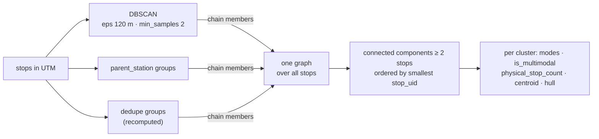

```text
labels = DBSCAN(eps=120 m, min_samples=2) on UTM coordinates
graph  = nodes: all stops
for each DBSCAN cluster, parent_station group, and dedupe group:
    link its members in a chain                 # connectivity only, not all pairs
clusters = connected components with >= 2 stops, ordered by smallest stop_uid

per cluster:
    modes               = distinct normalized route_type of routes serving members
    is_multimodal       = len(modes) > 1
    physical_stop_count = distinct canonical stations among members
    geometry            = centroid and convex hull, EPSG:4326
```

- Merging with `parent_station` and dedupe groups means a declared station or
  an aliased station is **never split**, even when its platforms are further
  apart than `eps`.
- `route_type` codes are normalized first: 700-series → bus 3, 100-series →
  rail 2, 400-series → metro 1, 900-series → tram 0.
- `physical_stop_count = 1` flags a **phantom** cluster: several records of a
  single station rather than a real interchange.
- Phase 3 dedupe uses whole-feed route evidence while Phase 2 uses the
  analyzed day, so Phase 3 typically finds **more** within-feed pairs
  (measured 2,752 versus 2,697). This is expected.

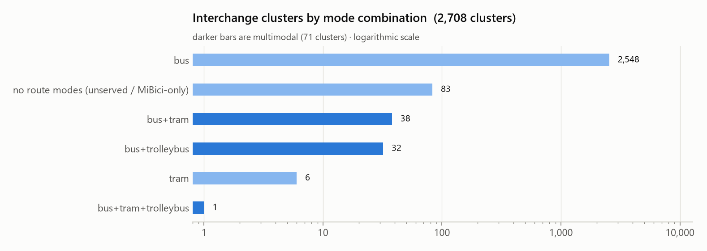

### Step 19. Cross-check transfers.txt

**Module** `conflation/transfers_check.py`.

```text
declared = (from_stop_uid, to_stop_uid) pairs from each feed's transfers.txt
for each declared pair:
    both stops in the same cluster → declared_co_clustered      (agreement)
    otherwise                      → declared_not_co_clustered  (+ not_inferred_examples)
for each cluster:
    contains a declared pair       → clusters_with_declared
    otherwise                      → clusters_without_declared  (inferred only)
```

A feed without `transfers.txt` is listed in `feeds_without_transfers`; that is
not an error.

### Step 20. Match stops to OSM transit nodes

Command `conflate-osm` · module `conflation/osm_match.py`.

The OSM schema is validated first — tables, geometry column, required tag
columns, SRIDs — and fails fast with every problem listed.

```sql
SELECT s.stop_uid, s.location_type, o.osm_id, o.kind, o.distance_m
FROM stops s
LEFT JOIN LATERAL (
    SELECT p.osm_id,
           <bus_stop | public_transport value | railway value> AS kind,
           ST_Distance(s.geom::geography, ST_Transform(p.way, 4326)::geography) AS distance_m
    FROM planet_osm_point p
    WHERE p.highway = 'bus_stop'
       OR p.public_transport IN ('platform', 'stop_position', 'station')
       OR p.railway IN ('station', 'halt', 'tram_stop')
    ORDER BY p.way <-> ST_Transform(s.geom, <point srid>)     -- index-assisted KNN
    LIMIT 1
) o ON TRUE;
```

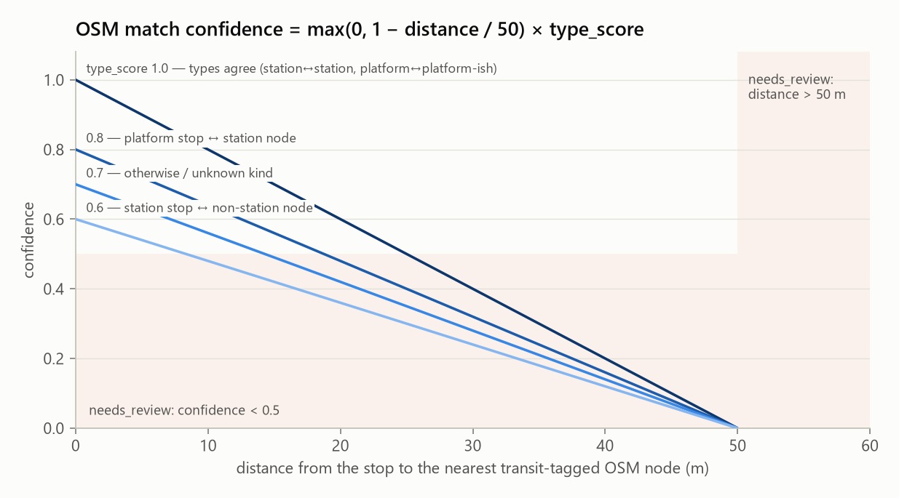

```text
distance_score = max(0, 1 − distance_m / 50)

type_score:
    stop is a station (location_type 1):  station-kind node → 1.0 ; otherwise → 0.6
    stop is a platform / other:           platform-kind → 1.0 ; station-kind → 0.8 ; other → 0.7

confidence   = round(distance_score × type_score, 3)
needs_review = no candidate  OR  distance_m > 50  OR  confidence < 0.5
```

The KNN ordering uses the OSM layer's own projection (Web Mercator here) and
the reported distance is then measured geodesically; at city scale the nearest
node by either measure is the same.

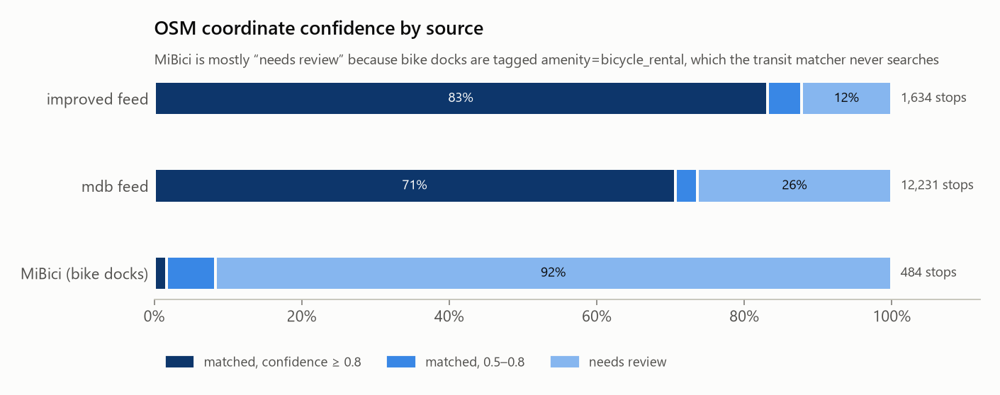

The tag list covers **public transport only**. Bike-share docks are tagged
`amenity=bicycle_rental` and are never searched, so MiBici comes back 92%
`needs_review` whatever its coordinate quality.

### Step 21. Determine side of street

**Module** `conflation/side_of_street.py`.

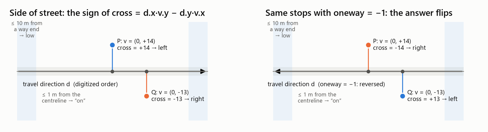

```text
1. nearest highway centerline to the stop (KNN); discard if farther than 50 m
2. in UTM, take the segment of that line nearest the stop
3. d = unit direction of the segment IN TRAVEL DIRECTION
       (digitized order; reversed when oneway is "-1" or "reverse")
   foot = perpendicular projection of the stop onto the segment
   v    = stop − foot
4. cross = d.x · v.y − d.y · v.x
5. side  = "on"    if |v| <= 1 m
           "left"  if cross > 0
           "right" if cross < 0
6. confidence = "low" if side is "on"
                      or foot within 10 m of either way end       # intersection proxy
                      or |v| < 2 m                                 # collinear noise
                else "high"
```

For two-way streets the side is relative to OSM digitization — stable but
arbitrary. Only `highway` ways are considered, so rail stations are matched to
whatever road is nearest, and centre-median BRT platforms fall in the
low-confidence `on` case.

### Step 22. Find OSM coverage gaps

**Module** `conflation/coverage.py`.

```sql
WITH area AS (
    SELECT ST_Buffer(ST_ConvexHull(ST_Collect(geom))::geography, 500)::geometry AS hull
    FROM stops
)
SELECT p.osm_id, kind, name, n.distance_m AS nearest_stop_m
FROM planet_osm_point p
JOIN area a ON ST_Intersects(ST_Transform(p.way, 4326), a.hull)
LEFT JOIN LATERAL (
    SELECT ST_Distance(s.geom::geography, ST_Transform(p.way, 4326)::geography) AS distance_m
    FROM stops s ORDER BY s.geom <-> ST_Transform(p.way, 4326) LIMIT 1
) n ON TRUE
WHERE <transit tag filter as in Step 20>
  AND (n.distance_m IS NULL OR n.distance_m > 100)
ORDER BY n.distance_m DESC NULLS FIRST;       -- worst gaps first
```

The result is a review list, not a verdict: a gap is either a hole in the
feeds or noise in OSM.

---

## Phase 4

### Step 24. Google QA and station locator (optional)

**Off by default** — runs only with `--enable-google-qa` (or
`--enable-google-api` for the locator) **and** `GOOGLE_MAPS_API_KEY` in the
environment.

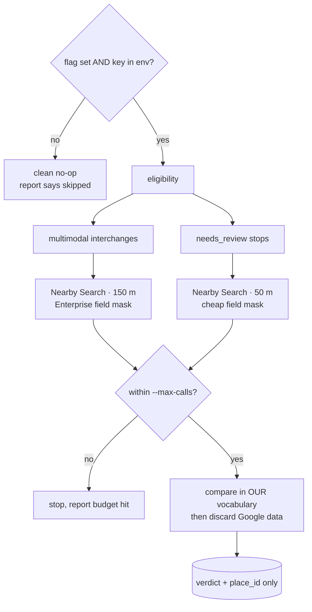

| Target | Verdicts |
| --- | --- |
| Multimodal interchanges | `CONFIRMED` (Google's modes cover ours) · `PARTIAL` · `CONFLICT` · `NO_DATA` |
| `needs_review` stops | `STATION_FOUND` · `NOT_FOUND` · `NO_DATA` |

Only the opaque `place_id` and the verdict are stored — enforced by a frozen
column allowlist. The **station locator** resolves station names (Text Search
anchored to the previous station, Geocoding fallback), computes consecutive
travel times, exports to Excel and never writes to the database.

---

## 2. Data model

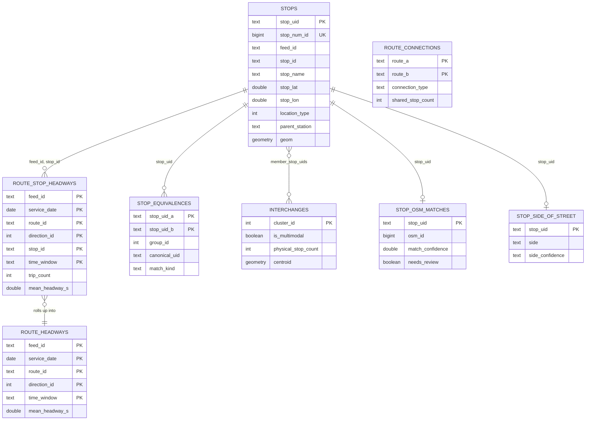

---

## 3. Worked example: Guadalajara

### Phase 1

| Source | Kind | Stops | Errors | Warnings |
| --- | --- | ---: | ---: | ---: |
| improved_gtfs_mimacro_mitren_sitren | zip | 1,634 | 0 | 1 (`feed_expired`) |
| mdb_2366_202502241922 | zip | 12,231 | 0 | 1 (`feed_expired`) |
| mibici | csv | 484 | 0 | 0 |
| **Total** | | **14,349** | **0** | **2** |

### Phase 2

| Step | Result |
| --- | --- |
| 6 Service date | typical weekday per feed: 2021-05-04 (improved) and 2024-06-27 (mdb); the calendars don't overlap, so **not coherent** (the old "busiest" rule picked the holidays 2020-01-01 and 2024-01-01) |
| 8 Headways | 107,398 stop-level rows, 2,152 route rollups, 287 routes (84 + 511 trips); 19 trips on 19 routes relabelled from stop order (e.g. `MT_L3`: 420 s per direction at peak, not 230–330 s) |
| 9 Links | mdb `MT_L1`/`MT_L2` list 60 alias stops under a shared `stop_sequence` (0 m apart); one kept per sequence, so 0-minute arcs drop from 31 to 1 |
| 11 Dedupe | 3,584 pairs accepted among served stops; 772 rejected as same-feed conflicts |
| 11 Stations | 12,768 served records → **10,203** physical stations (11,054 keeping unserved stops, 10,533 before the conflict rule) |
| 11b Route dedupe | 38 lines in both feeds (Jaccard ≥ 0.909), all kept from mdb; improved keeps `MP-A05-2` and `ST_L1B`; 8 Sitren trips listed twice in mdb |
| 12 Connectivity | 249 routes, 7,902 route pairs: 3,810 `same_stop`, 830 `same_station_dedup`, 3,262 `proximity` (287 routes and 10,255 pairs without route dedupe) |
| 13 Walk graph | 129,039 ways → 512,420 vertices, 1,186,804 directed edges |
| 13 Routing | 87,708 of 91,773 pairs on streets; typical walk 1.33× the straight line |
| 15 `walk_source` | network 12,252 · mixed 1,356 · none 451 · straight_line 290 |
| 16 Station network | 12,768 nodes (1,581 never-served stops left out); 24,036 in_vehicle + 144,572 walk + 5,624 same_station arcs; **1 weak component** among transit stops, 9 stops one-way reachable (route terminals); in_vehicle `time_quality`: ok 24,013 · too_fast 18 · too_slow 4 (T16B-C07-C, T16B-C08-M) · zero 1; 42,557 walk + 247 same_station pairs redundant (with `--prune-station-network`: 59,458 walk + 5,130 same_station arcs, same shortest times) |
| 16b Timetable | 3,290,920 connections in 66,568 runs over 10,499 served stops (`connections.csv.gz`, 61 MB); footpaths: 101,018 walk · 10,499 self · 226 same_station (120 s change time); a CSA scan from 08:00 reaches 99.8–99.9 % of stops |

### Phase 3

| Step | Result |
| --- | --- |
| 18 Interchanges | 2,708 clusters, 71 multimodal, 809 single-station phantoms |
| 20 OSM match | 10,485 of 14,349 matched (73.1%); 3,864 need review |
| 21 Side of street | right 9,664 · left 3,804 · on 881; 2,833 low confidence |
| 22 Coverage gaps | 34 OSM-only transit nodes |

### Choosing `--proximity-m`

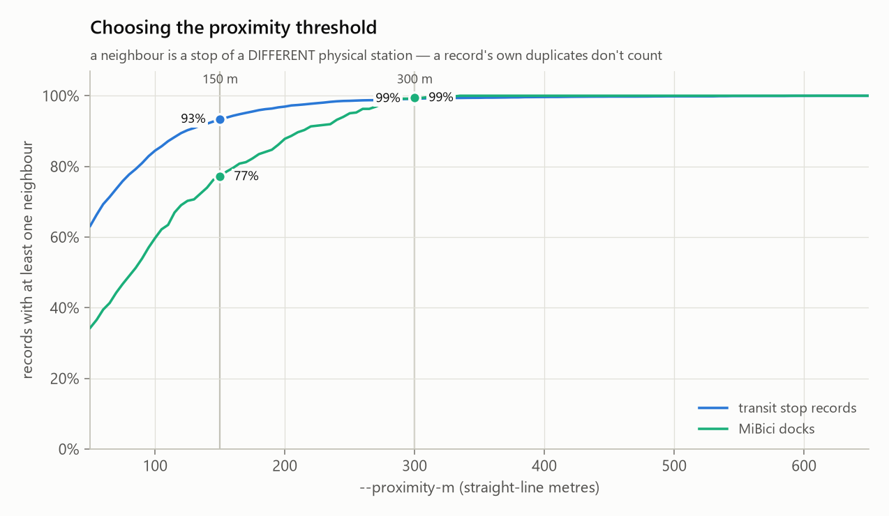

A "neighbour" here is a stop of a **different** physical station. At 150 m,
82% of transit records and 78% of MiBici docks have one; at 300 m, 97% and
99%.

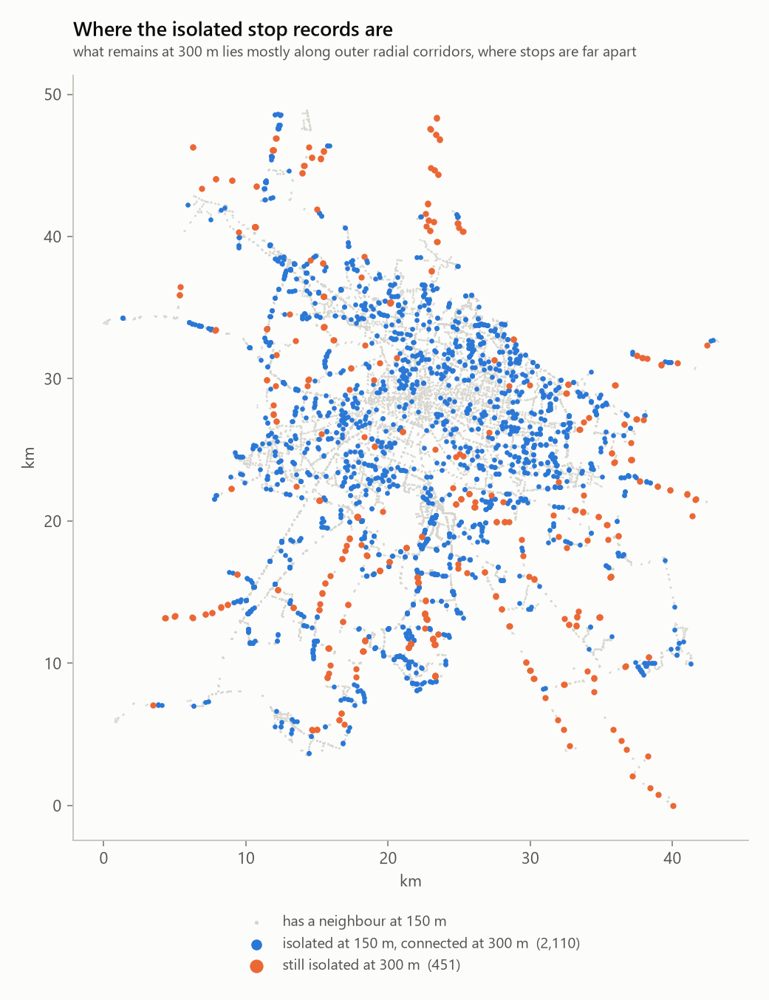

Raising the threshold to 300 m connects 2,110 records; the 451 still isolated
lie mostly along outer radial corridors where stops really are far apart.

Measured on the October 2026 runs (busiest date, unserved stops kept):

| | 150 m | 300 m |
| --- | ---: | ---: |
| Isolated stations | 1,236 | 206 |
| — of which MiBici | 107 | 3 |
| Weak components in the station network | 256 | 55 |
| Route connectivity edges | 7,943 | 9,112 |

---

## 4. Parameter reference

| Parameter | Default | Step | Controls |
| --- | --- | --- | --- |
| `--analysis-date` | today | 3, 6 | reference date for expiry and staleness notes |
| `--service-date` / `--date-rule` | typical weekday per feed | 6 | the day analyzed |
| `--common-date` | off | 6 | one shared day across feeds |
| `--service-date-range` | — | 6 | every served day in a window, ≤ 31 |
| `--window NAME=HH:MM-HH:MM` | 4 windows | 8 | headway windows |
| `--transport-mode`, `--route` | all | 6–9 | analyzed routes (union of both) |
| `--proximity-m` | 150 | 10, 12, 14, 16 | what counts as "near" |
| `--dedupe` / `--no-dedupe` | on | 11 | station deduplication |
| `--dedupe-distance-m` | 30 | 11 | cross-feed radius |
| `--dedupe-name-threshold` | 0.75 | 11 | cross-feed name similarity |
| `--dedupe-within-feed-distance-m` | 5 (0 = off) | 11 | within-feed radius |
| `--route-dedupe` / `--no-route-dedupe` | on | 11b | one source per line in routing inputs |
| `--network-walk` | off | 13 | walking on OSM streets |
| `--walk-cache` / `--walk-cache-dir` | on / `.gtfs_cache` | 13 | walk-graph cache |
| `--fix-directions` / `--no-fix-directions` | on | 8 | direction_id from stop order on mixed routes |
| `--min-transfer-s` | 120 | 16b | change time in `footpaths.csv` |
| `--eps`, `--min-samples`, `--crs` | 120, 2, auto UTM | 18 | DBSCAN |
| `--match-threshold-m` | 50 | 20 | OSM match radius |
| `--street-threshold-m` | 50 | 21 | centerline radius |
| `--coverage-radius-m`, `--coverage-buffer-m` | 100, 500 | 22 | gap detection |
| `--max-calls` | 200 | 24 | Google call budget |

Fixed constants: walking speed 83 m/min · in-vehicle fallback 25 km/h · vertex
grid 0.1 m · snap label 200 m · Dijkstra limit 800 m · walk hull buffer
1,000 m · Dijkstra batch 16 sources · 1,000 synthetic runs per frequency row ·
side-of-street tolerances 1 m / 10 m / 2 m.

---

## 5. Interpretation pitfalls

1. **Records are not stations.** Use `COALESCE(station_dedup, stop_uid)` for
   any station count, density or coverage figure (§1.5).

2. **A station is one platform group, not one name.** Opposite-direction
   platforms stay separate stations (Step 11, same-feed conflicts); join
   them by walking links, not by dedupe.

3. **Check `service_dates_coherent`.** Different service days across feeds
   mean cross-feed outputs mix schedules. Pin one with `--service-date`.

4. **`direction_id` is unreliable in these feeds.** Several trunk lines use
   `0` for both directions. By default the pipeline relabels those routes from
   their stop order (`direction_fixes.csv`); without it, headways count both
   ways together. `ST_L3` keeps its labels: its two senses use different
   platform ids, so no stop mixes them.

5. **Empty `system` has several causes** — a stops-only source, a stop unserved
   on the analyzed date, a parent station, or missing agency metadata. Identify
   stops-only sources by `feed_id`, never by `system`. (Stops that *no* trip
   ever serves are left out entirely by default; see `--drop-unserved-stops`.)

6. **Headways don't vary by time of day here** (Step 8), because the source
   data defines uniform frequencies. That is a property of the feeds, not a
   finding about the city's service.

7. **Use the median detour factor** (1.33×), not the mean (Step 13).

8. **`needs_review` for bike docks is a matcher-scope result**, not a coordinate
   problem (Step 20).

9. **`-` in a `near_stations` tuple** marks a neighbour no line serves; parsers
   of the line field must accept it (Step 14).

10. **Phase 2 and Phase 3 dedupe counts differ** by design (Step 18).

11. **`--proximity-m` changes more than neighbour lists** — it also changes
    route `proximity` edges, so connectivity figures are comparable only
    between runs with the same threshold.
